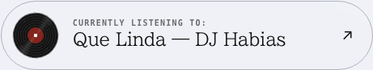

# Portfolio: shader, listening record and whole-experience review

19 October 2026. Implementation and release review.

## Judgment

**REFINE.** The premise is specific and worth preserving: a designer who builds brand systems and the tools that keep them usable. The large serif statements, restrained rules and Print/Screen distinction communicate an authored practice. The larger weakness is the gap between that promise and the evidence available after arrival. More decorative motion would not close it.

This is a self-review using Scale Design Intent, Creative Direction, Casey, Loewy and Design Engineering. A separate review agent could not run because its usage limit was reached; no independent-agent agreement is claimed. Visual evidence includes the live Proof Sheet record and local desktop/mobile hero, profile and record renders. Code inspection covers the active CSS cascade, project renderers, theme/motion controller, shader island, lifecycle and listening API client. Automated route checks supplement this; they are not audience research.

## Implemented

The light water material previously used the upstream expression `mix(..., color3, vPos.z)`. The last weight was unbounded. Material lighting also changed the supplied colours. Correct CSS variables therefore did not guarantee correct pixels. The new light-only fragment pass uses `smoothstep` weights and directly interpolates paper, neutral-96 and neutral-94. Geometry, displacement and camera remain authored; the dark material remains separate. The backgrounds remain paper and neutral-95. These tokens contain a slight cool tint; the fix prevents extra blue or other colours outside their range rather than inventing a new white palette.

The record is reconstructed from https://miebaka-proof-sheet.vercel.app/css/style.css and its rendered component: 3.2s rotation, reflective sectors, 56px disc, centred 20px label/spindle, outline pill, serif title, compact mono status, rolling arrow and reference easing. Portfolio colour tokens and current text remain. Mobile retains its compact adaptation. Reduced motion stops the disc and arrow; focus remains visible. The Last.fm live/recent update remains intact.

Shader teardown now cancels its readiness frame. Import failure removes both hosts; partial mount failure disposes the already-mounted renderer.

## Priorities and concrete changes

The rows below distinguish completed repairs from recommendations. Quoted code is from the current implementation or the replaced code. Confidence is high for code observations; interpretations of visitor response are medium unless stated otherwise.

| Before | After | Why |
| --- | --- | --- |
| **Fixed:** `mix(..., color3, vPos.z)` followed by physical lighting | Bounded `smoothstep` interpolation in `LIGHT_FRAGMENT` | Token names alone were insufficient. Success: animated light pixels and dark-to-light switching stay within delegated surface colours. [[contrast-and-color-scheme]] |
| **Fixed:** `.now-playing__vinyl::after` was a static centre disk; `<i></i>` had no styling | Centre label belongs to `i`; `::after` supplies rotating reflective sectors | A symmetric groove pattern cannot visibly communicate rotation without asymmetric highlights. Success: recognisable spinning vinyl, with a still reduced-motion state. [[states-are-the-work]] |
| **Fixed:** four entries in `renderHomeProjectList()` were disabled buttons with only a project name | Static rows now say “Case study in progress”; only TEDx keeps a link affordance | Availability is clear before a visitor tries to click, while the large editorial list remains intact. [[content-authenticity]] |
| **Fixed:** Detour and Out Of Office reused Rivo's description | Both use the factual status “Case study in progress” until verified project copy exists | Removing a false claim is stronger than inventing a polished one. [[content-authenticity]] |
| **Fixed:** the homepage profile used a large blue portrait placeholder | The approved responsive portrait is now the image fallback | The biography now carries real evidence instead of an unfinished surface. [[empty-loading-states]] |
| **Fixed:** two plain `Print | Screen` buttons | A compact Kokonut-derived rope simulation acts as one accessible switch | Pull Cord makes the portfolio's Print/Screen idea physical; the generic morphing switch would be interchangeable with an app setting. [[interaction-personality]] |
| **Should improve:** `mountShaderGradient(host, getState())` and `mountShaderGradient(overlayHost, getState())` | Prototype a single shared field or suspend the obscured renderer, preserving the sticky reveal | Two React/Three contexts render the same field. This establishes duplicate work, not a measured battery or frame-rate failure. Success: unchanged hero-to-content transition with fewer active contexts and measured lower frame cost. [[performance-discipline]] |
| **Should improve:** `.home-profile__listening{...margin-top:...;...margin:0}` and repeated property declarations in the active CSS | Consolidate each selector to its final intentional declarations, then compare rendered states | The cascade currently passes duplicate-selector checks while still containing contradictory properties inside a rule. This makes future revisions harder to reason about. Success: identical screenshots with one effective declaration per property/context. [[code-tells]] |
| **Should improve:** `renderHomeProjectList()` and `renderProjectArchiveMarkup()` each define a separate project list | Give ordered home/archive selections a single content source, with explicit title/status overrides only where needed | Separate lists already disagree with project metadata and invite further drift. Success: one status change updates availability consistently across surfaces. [[component-api-design]] |

## Creative reading

**Glance:** the oversized serif proposition is the dominant signal. Its scale is intentional and should remain. The quiet light water should act as paper atmosphere rather than compete with the type.

**Scan:** selected work appears before biography, which supports the evidence-first intent. But only TEDx is currently a destination in the five-row home selection. The ordering is structurally sound; the available proof is thin. Resolve availability and project truth before adding sections.

**Study:** the record adds specific personality and a small crafted detail. It earns its motion through the physical metaphor of a turning record. Repeated generic project descriptions and the portrait placeholder undermine that same authorship.

Idea: **Strong**. Communication: **Developing**, because the project list promises more access than it supplies. Execution: **Developing**, primarily due to incomplete imagery and CSS maintainability. Taste: **Strong in direction**, with a refinement verdict for the unfinished evidence surfaces. Use/performance: automated checks recorded below; no real-device thermal, battery or longitudinal usability evidence.

## Kokonut UI and Motion placement audit

| Before | After | Why |
| --- | --- | --- |
| Global theme uses a text pair | **Implemented:** Pull Cord in the masthead | This is the highest-fit external component because it turns the authored Print/Screen metaphor into a memorable physical action. |
| Homepage listening state used a generic disc | **Implemented in the preceding pass:** Proof Sheet vinyl pill | The rotating record explains live listening state and earns its continuous motion. |
| Long case studies are primarily reading surfaces | Keep chapter transitions and scrolling quiet | Motion scroll effects here would repeat often and compete with project evidence; reserve Motion-style springs for interruptible gestures such as the cord. |
| Service accordions already expose state and content clearly | Keep their current short height/opacity response | Another imported component would add a second interaction dialect without solving a problem. |
| Contact form uses direct fields and one action rail | Keep it stable; improve only validation feedback as needs emerge | A novelty input would make a high-intent task less predictable. |

The Kokonut Switch Button remains a sound compact control and has a careful View Transitions fallback, but it is less specific to this portfolio. Motion's JavaScript API is compatible with this static stack; no dependency was added because the needed spring-like rope feedback is self-contained and the current JavaScript budget is deliberately small.

MAYA is balanced: familiar editorial reading and recognisable vinyl support the more distinctive scale and Print/Screen world. Keep the typography, spaciousness, project-first sequence, hairlines, dark composition and concise closing invitation. The highest-leverage next step is to make the evidence as complete and specific as the presentation.

## Validation

Validation results are appended after the final runs. The shader pixel test samples an unobstructed region in the actual viewport, checks RGB bounds through light → dark → light, and runs alongside the vinyl movement/reduced-motion checks. Sampling supports the regression check; the bounded fragment expression establishes the palette constraint across its full output.

- `npm test`: 144 tests passed, plus build and CSS contract checks.
- Full browser suite: 153 existing scenarios passed; five of six new checks passed initially. The remaining new mobile pixel check timed out because it enlarged a 3× phone viewport to desktop dimensions. Corrected to sample the native viewport; all six new checks then passed across desktop, mobile and reduced motion. No assertion was weakened.
- Asset budgets passed: CSS 20.5 KiB/45 KiB; initial JS 1.0 KiB/75 KiB; lazy shader 345.2 KiB/375 KiB; homepage media 20.9 KiB/1536 KiB.
- Lighthouse: all assertions passed across three runs each of home, work and TEDx. Performance 100 in all nine local desktop runs; LCP 452–691ms, CLS below 0.008, TBT 0ms. These are local lab measurements; the delayed shader and ongoing GPU work are not fully represented by startup metrics.
- The visual harness now explicitly waits for both shader hosts and two paint frames. Previously it could capture before the shader was ready. Software-WebGL homepage capture receives the same longer deadline locally as on CI; pixel tolerances are unchanged.
- No commit, push or deployment was performed. Existing owner edits under `New Look/Homepage/` were preserved.
- Final visual checks: all 20 desktop/mobile route-theme comparisons passed (10 reduced-motion screenshot duplicates intentionally skipped by the existing suite). The initial desktop dark capture timed out; rerunning with the explicit shader-ready gate and software-rendering deadline passed. Existing comparison tolerances were retained.

